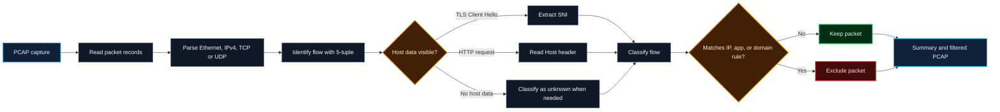
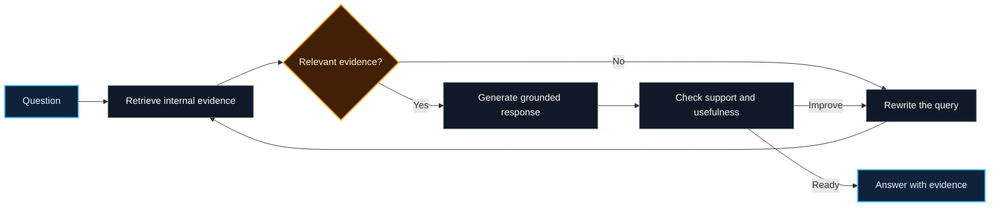

 

<table>
<tr>
<td width="60%" valign="middle">

## 👨‍💻 About me

I'm a **Full-Stack Developer and AI Engineer** pursuing Computer Science at **IIIT Bhagalpur**. I like taking a problem from packet parsing or product idea through backend logic and into a usable interface.

- 🎓 **B.Tech in CSE, IIIT Bhagalpur** · CGPA **9.15/10** · 2024–2028
- 💼 **Full Stack Developer Intern, AMUS SOFT** · Jul–Aug 2026
- 🔭 Building **PacketLens** and full-stack applications; exploring **Medisaathi**, a smart appointment and queue management system
- 🌱 Learning **System Design, advanced backend development, Redis, and scalable architecture**
- 🧠 Interested in **AI applications, RAG, multi-agent systems, and real-time products**
- 🧩 Solved **850+ problems** across Codeforces, CodeChef, and LeetCode
- 🤝 Open to collaboration on **MERN, AI-powered apps, open source, and real-time projects**
- 💬 Ask me about **React, Node.js, Express, MongoDB, REST APIs, JWT, Socket.IO, DSA, and competitive programming**

</td>
<td width="40%" align="center" valign="middle">

**Idea → architecture → implementation → ship**

</td>
</tr>
</table>

## 📡 PacketLens — watch a packet travel

An animated walkthrough: a packet travels from the **client**, through a **router**, and reaches the **PacketLens rule engine**. The YouTube example matches a block rule and gets dropped; an allowed packet continues to the server. This is an explanatory visualization of the project’s filtering flow.

### What happens inside the analysis

**Project stack:** `Python` · `TCP/IP` · `TLS` · `HTTP` · `PCAP` · `Pytest` · `Docker`

> PacketLens focuses on classic Ethernet PCAP and IPv4 TCP/UDP. It extracts TLS SNI and HTTP Host when available in a packet; it does not reassemble TCP payloads split across packets, and encrypted traffic may hide host details.

## 🚀 Projects I enjoy building

| Project | What it does | Technologies |
|---|---|---|
| **PacketLens** | Deep packet inspection engine that parses PCAP, identifies flows, extracts visible host details, applies rules, and produces a filtered capture. | Python, TCP/IP, TLS, HTTP, PCAP, Docker |
| **Medisaathi** | Smart appointment and queue management system. | MERN stack, full-stack development |
| **CampusConnect** | Real-time college intranet for **500+ students**, with messaging and secure role-based access. | React, Node.js, Express, MongoDB, Socket.IO |
| **AI Notes Generator** | Generates notes with the Gemini API. | AI API integration, web development |
| **Zesto Food Delivery** | Full-stack food ordering platform. | MERN stack |
| **CloudOps Sentinel** | Self-RAG incident response copilot with relevance grading, query rewriting, evidence checks, and private knowledge-base retrieval. | LangGraph, OpenAI, Pinecone, FastAPI, SQLite |
| **Cold-Chain Logistics** | Agentic dispatch console that brings fleet data, weather, and operating procedures into one workflow. | LangGraph, Python, SQL Server, Pinecone, AWS EC2 |

### 🧠 How my RAG projects reason

## 🧰 Technologies

<b>AI engineering, RAG & evaluation</b>

 

`LangGraph` `LangChain` `OpenAI API` `Gemini API` `AI Agents` `Multi-Agent Systems` `Tool Calling` `MCP` `Prompt Engineering` `Structured Outputs` `Human-in-the-Loop` `RAG` `Self-RAG` `Agentic RAG` `CRAG` `Hybrid Search` `Semantic Search` `BM25` `Embeddings` `Reranking` `Vector Search` `RAGAS` `DeepEval` `LangSmith` `LLM-as-a-Judge` `Hallucination Detection`

<b>Languages, frontend & backend</b>

 

`C` `C++` `Python` `JavaScript` `SQL` `HTML` `CSS` `React` `React Native` `Redux Toolkit` `React Router` `React Hook Form` `Node.js` `Express.js` `FastAPI` `REST APIs` `WebSockets` `Socket.IO` `JWT` `RBAC` `PHP`

<b>Databases, cloud & developer tools</b>

 

`PostgreSQL` `MongoDB` `Redis` `MySQL` `SQL Server` `SQLite` `Pinecone` `Firebase` `AWS EC2` `Docker` `Nginx` `Linux` `Git` `GitHub` `GitHub Actions` `CI/CD` `Vercel` `Pytest` `Postman` `Vite` `Tailwind CSS` `Sass` `Bootstrap` `Three.js`

<b>Also used</b>

 

`Nodemon` `Canva` `NumPy` `Pandas` `Matplotlib`

## 🏅 Competitive programming

| Codeforces | CodeChef | LeetCode |
|:---:|:---:|:---:|
| **Specialist** · peak **1410** | **3-Star** · peak **1653** | Contest rating **1694** |
| 468 problems | 224 problems · 31 contests | Top **14.69%** |

**850+ problems solved** across platforms · DSA, graphs, dynamic programming, and greedy algorithms

## 📊 GitHub activity

 

## 🌱 Beyond the code

- **Web Developer**, IIIT Bhagalpur Development Team · 2024–present
- **Class Representative** · 2024–present
- **Hackathon Team Lead** · led a four-member team through architecture, implementation, and debugging
- Certifications: **Cisco Introduction to Cybersecurity**, **Adobe University Hackathons**, and **Machine Learning and Deep Learning in Agriculture and Biomedical Engineering** at IIIT Bhagalpur
- I enjoy building scalable applications and solving challenging algorithmic problems.

### Have an interesting product or open-source idea? Let's build.

Previously listed email: <a href="mailto:pradeepkumariiitbhagalpur@gmail.com">pradeepkumariiitbhagalpur@gmail.com</a>

