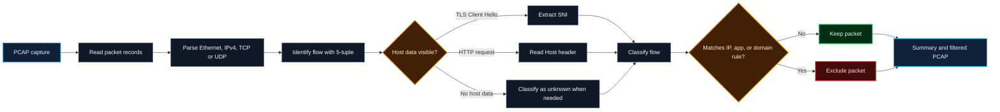
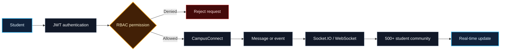
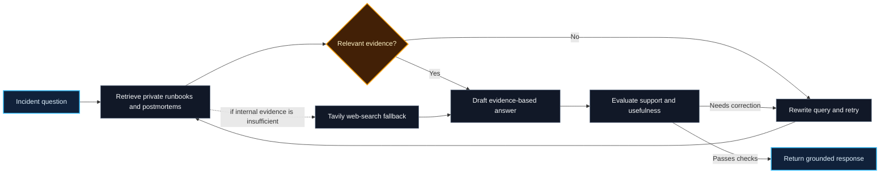
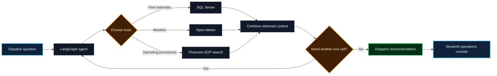

 

<table>
<tr>
<td width="60%" valign="middle">

## 👨‍💻 About me

**Computer Science and Engineering undergraduate at IIIT Bhagalpur** with experience in full-stack development, AI engineering, backend systems, and competitive programming.

- 🎓 **B.Tech in CSE, IIIT Bhagalpur** ·  · 2024–2028
- 💼 **Full Stack Developer Intern, AMUS SOFT** · Jul–Aug 2026
- 🧠 Focus areas: **AI engineering, RAG and retrieval, backend and full-stack development**
- 🧩 Solved **850+ problems** across Codeforces, CodeChef, and LeetCode

</td>
<td width="40%" align="center" valign="middle">

</td>
</tr>
</table>

## 📡 PacketLens — watch a packet travel

### What happens inside the analysis

**Project stack:** `Python` · `TCP/IP` · `TLS` · `HTTP` · `PCAP` · `Pytest` · `Docker`

> PacketLens focuses on classic Ethernet PCAP and IPv4 TCP/UDP. It extracts TLS SNI and HTTP Host when available in a packet; it does not reassemble TCP payloads split across packets, and encrypted traffic may hide host details.

## 🚀 Resume projects — visual flows

### 💬 CampusConnect · Real-Time College Intranet

`React` · `Node.js` · `Express.js` · `MongoDB` · `Socket.IO` · `JWT` · `RBAC`

### 🛡️ CloudOps Sentinel · Incident Response Self-RAG Copilot

`LangGraph` · `OpenAI GPT-5-mini` · `Pinecone` · `FastAPI` · `SQLite` · `Tavily` · `IsSUP` · `IsUSE`

### 🚚 Cold-Chain Logistics · Agentic Dispatch Console

`LangGraph` · `Python` · `SQL Server` · `Open-Meteo` · `Pinecone` · `Streamlit` · `AWS EC2` · `GitHub Actions`

## 🧰 Technologies

<b>AI engineering, retrieval & evaluation</b>

 

`LangGraph` `LangChain` `OpenAI API` `Gemini API` `AI Agents` `Multi-Agent Systems` `Tool Calling` `Function Calling` `MCP` `Prompt Engineering` `Structured Outputs` `Human-in-the-Loop` `RAG` `Self-RAG` `Agentic RAG` `CRAG` `Hybrid Search` `Semantic Search` `BM25` `Embeddings` `Query Rewriting` `Reranking` `Vector Search` `RAGAS` `DeepEval` `LangSmith` `LLM-as-a-Judge` `IsSUP` `IsUSE` `Faithfulness` `Groundedness` `Hallucination Detection`

<b>Languages, frontend & backend</b>

 

`C` `C++` `Python` `JavaScript` `SQL` `HTML` `CSS` `React.js` `Redux Toolkit` `Node.js` `Express.js` `FastAPI` `REST APIs` `WebSockets` `Socket.IO` `JWT` `RBAC`

<b>Databases, cloud & developer tools</b>

 

`PostgreSQL` `MySQL` `SQL Server` `MongoDB` `Redis` `Pinecone` `SQLite` `Vector Databases` `AWS EC2` `Docker` `GitHub Actions` `CI/CD` `Linux` `Git` `GitHub` `Nginx` `Postman` `Pytest` `Deployment Automation`

<b>System design & computer science</b>

 

`HLD` `LLD` `OOP` `SOLID` `Microservices` `Distributed Systems` `API Integration` `Enterprise Integration` `Solution Architecture` `Rapid Prototyping` `Debugging` `Data Structures & Algorithms` `Operating Systems` `DBMS` `Computer Networks` `TCP/IP` `HTTP` `TLS`

## 🏅 Competitive programming

| Codeforces | CodeChef | LeetCode |
|:---:|:---:|:---:|
| **Specialist** · peak **1410**, current **1339** | **3-Star** · peak **1653** | Contest rating **1694** |
| 468 problems | 224 problems · 31 contests | Top **14.69%** |

**850+ problems solved** across platforms · DSA, graphs, dynamic programming, and greedy algorithms

## 💼 Experience & leadership

- **Full Stack Developer Intern**, AMUS SOFT · Remote · Jul–Aug 2026
- **Web Developer**, IIIT Bhagalpur Development Team · 2024–present
- **Class Representative** · 2024–present
- **Hackathon Team Lead** · led a four-member team through architecture, implementation, and debugging

## 📜 Certifications

- Introduction to Cybersecurity · Cisco Networking Academy
- Adobe University Hackathons · Adobe
- Machine Learning and Deep Learning in Agriculture and Biomedical Engineering · IIIT Bhagalpur

### Contact

