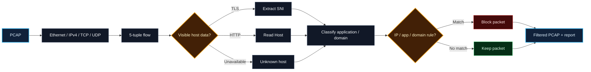
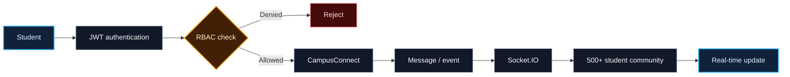
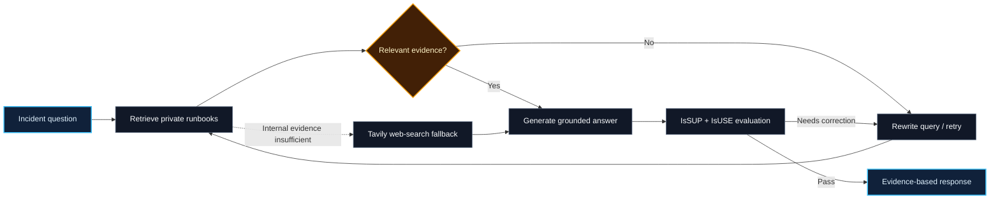
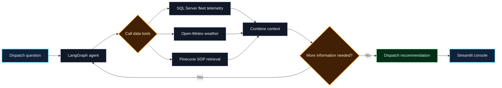

<table>
<tr>
<td width="60%" valign="middle">

## About me

Computer Science and Engineering student at **IIIT Bhagalpur** with experience in full-stack development, AI engineering, and backend systems.

- **Full Stack Developer Intern**, AMUS SOFT · Jul–Aug 2026
- **850+** problems solved across Codeforces, CodeChef, and LeetCode
- Focus: **RAG, AI agents, backend development, and system design**

</td>
<td width="40%" align="center" valign="middle">

</td>
</tr>
</table>

## Projects · visual flows

### PacketLens · Deep Packet Inspection

`Python` · `TCP/IP` · `TLS` · `HTTP` · `PCAP` · `Pytest` · `Docker`

### CampusConnect · Real-Time College Intranet

`React` · `Node.js` · `Express.js` · `MongoDB` · `Socket.IO` · `JWT` · `RBAC`

### CloudOps Sentinel · Incident Response Self-RAG Copilot

`LangGraph` · `OpenAI GPT-5-mini` · `Pinecone` · `FastAPI` · `SQLite` · `Tavily`

### Cold-Chain Logistics · Agentic Dispatch Console

`LangGraph` · `Python` · `SQL Server` · `Pinecone` · `AWS EC2` · `GitHub Actions`

## Core stack

`Python` `C++` `JavaScript` `React` `Node.js` `Express.js` `FastAPI` `LangGraph` `LangChain` `RAG` `OpenAI API` `Gemini API` `PostgreSQL` `MongoDB` `Redis` `Pinecone` `Docker` `AWS EC2` `GitHub Actions`

## Highlights

| Codeforces | CodeChef | LeetCode |
|:---:|:---:|:---:|
| Specialist · peak **1410** | 3-Star · peak **1653** | Rating **1694** · top **14.69%** |
| 468 problems | 224 problems · 31 contests |  |

**Education:** B.Tech CSE · IIIT Bhagalpur · 2024–2028

**Leadership:** Web Developer, IIIT Bhagalpur Development Team · Class Representative · Hackathon Team Lead

**Certifications:** Cisco Introduction to Cybersecurity · Adobe University Hackathons · Machine Learning and Deep Learning in Agriculture and Biomedical Engineering, IIIT Bhagalpur

